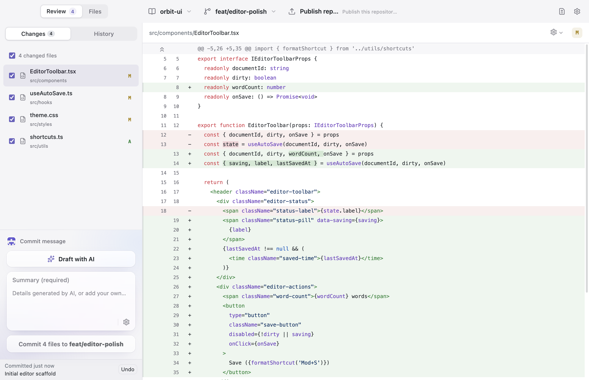
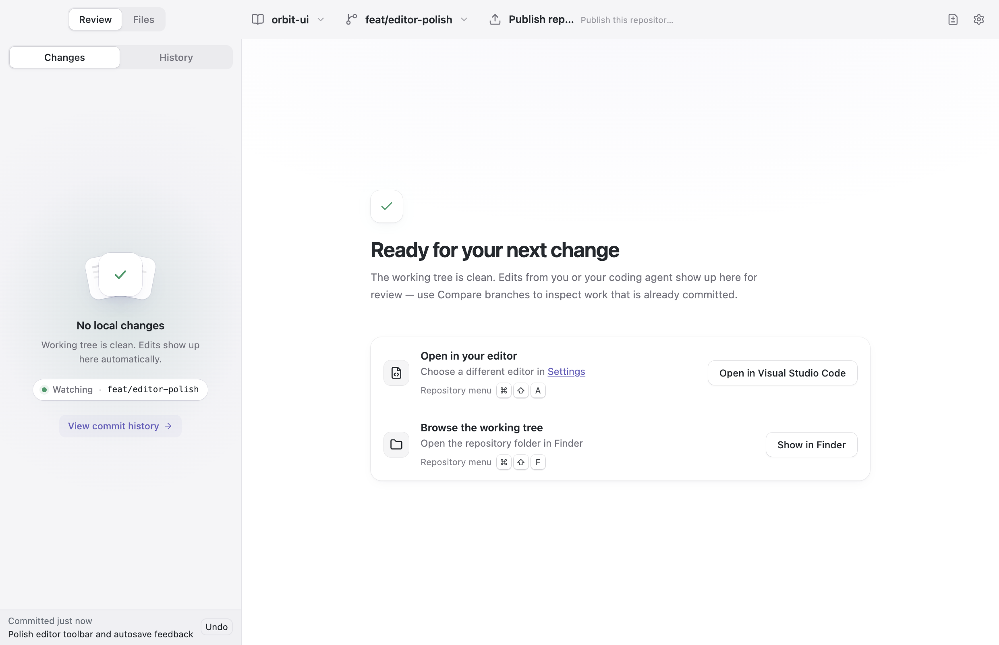
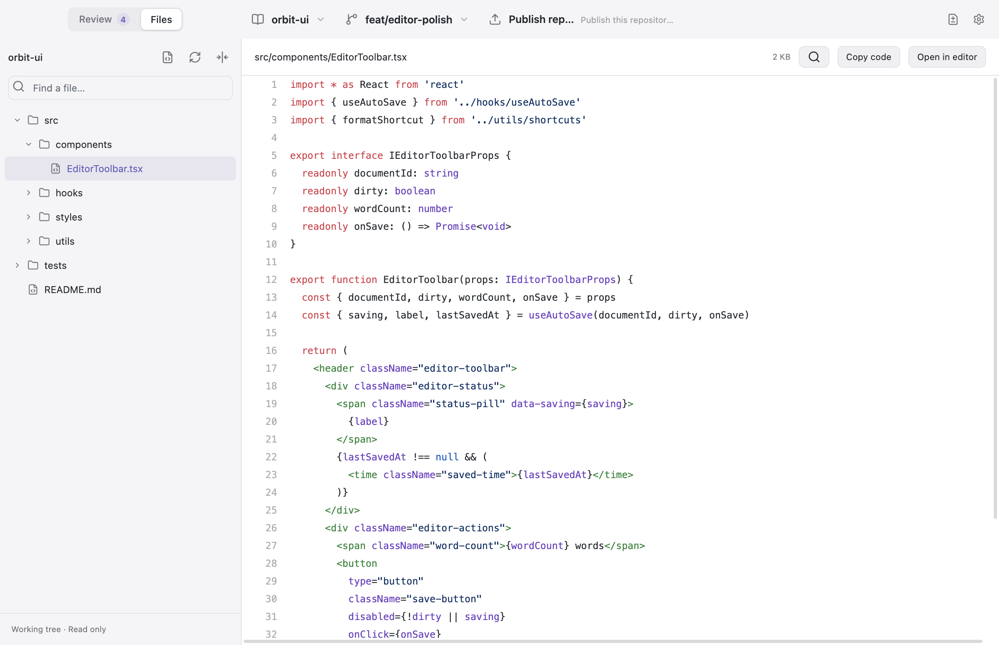
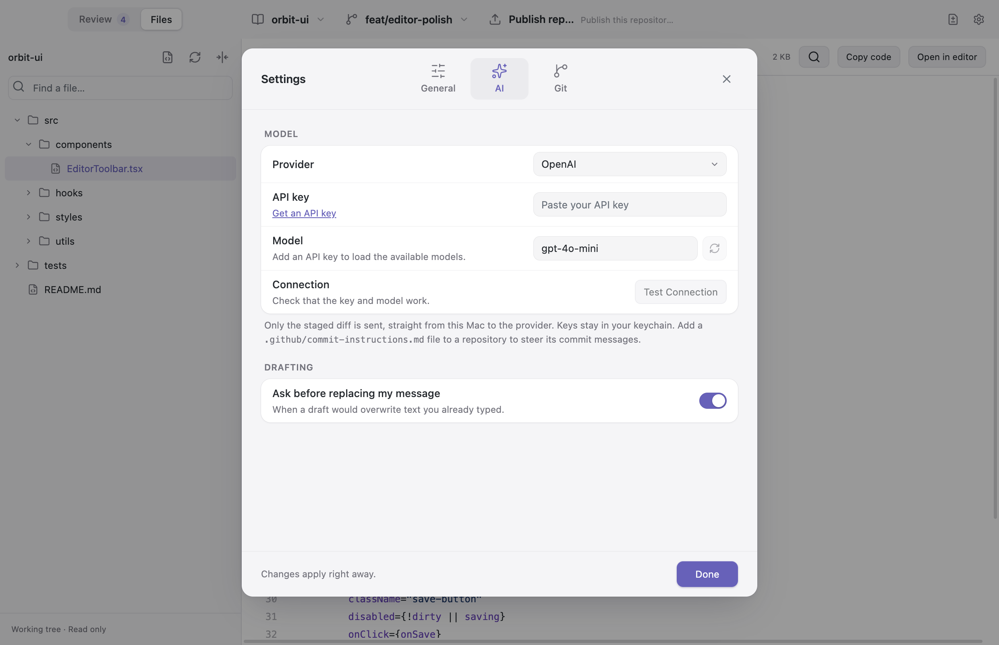

# GitHub Desktop Lite

基于官方 [GitHub Desktop](https://github.com/desktop/desktop)（`3.6.9-beta1`，MIT）深度精简与重设计的桌面客户端——**更小体积、更低内存、自带 AI 模型写 Commit，以及专为代码评审与阅读打造的极简双工作区。**

> 本项目基于官方开源代码改造，现作为独立仓库维护，不再跟随上游自动更新；应用名、Bundle ID（`com.leeir.GitHubDesktopLite`）、数据目录、钥匙串条目与 OAuth 回调协议均完全独立，可与官方 GitHub Desktop 并存使用。



## 核心优势

- **更轻更快，内存显著收敛**
  - **去掉重型冗余模块**：移除 Copilot Runtime、使用遥测上报、自动更新器、新手引导与约 120 MB 的内置 .NET Git Credential Manager；macOS arm64 安装包从官方约 **1.1 GB** 降至 **约 335 MB**。
  - **保留 dugite 软链接**：打包阶段保持约 145 个 git 子命令符号链接（不展开重复副本），兼顾体积与启动速度。
  - **运行时性能与内存治理**：首屏按需异步分包（`@xterm/xterm`、设置、分支对比与低频弹窗懒加载）、单语法高亮 Worker 串行复用、非活跃仓库闲置 5 分钟自动裁剪缓存、窗口失焦暂停装饰动画、隐藏窗口定时清理 WebFrame 缓存。
- **自带模型写 Commit Message（BYOK）**
  - 无需 Copilot 订阅，填入自己的 API Key 即可一键生成规范的标题与详细描述。
  - 内置 **OpenRouter、OpenAI、Anthropic、Google Gemini、DeepSeek、Moonshot (Kimi)、智谱 (GLM)、阿里百炼 (Qwen)、SiliconFlow、Ollama、LM Studio** 及自定义 OpenAI 兼容接口。
  - Key 仅保存在系统钥匙串中，由主进程 `net.fetch` 直接发起请求（遵循系统代理）；支持读取仓库内 `.github/commit-instructions.md` 作为自定义提交规范（diff 超过 6 万字符按文件智能截断）。
- **全新 Review / Files 双工作区**
  - **专注评审流（Review）**：精简顶栏布局、文件状态统一单字母标识（`A` / `M` / `D` / `R` / `C` / `!`）、文件变更轻量自动刷新；工作区无改动时自动切换极简空状态并收起提交框，改动文件超过 20 个自动显示筛选器。
  - **轻量代码阅读（Files）**：目录树按需展开（不建常驻索引），支持快速文件名过滤、单文件只读语法高亮预览（上限 256 KiB / 10,000 行）与 `⌘F` 页内查找。
- **顺手的本地与多仓库管理**
  - **直连本地目录**：选择文件夹即可直接添加并打开本地 Git 仓库；首次打开无需登录 GitHub 账号也可使用。
  - **一键批量快进拉取**：按顺序对所有已添加仓库的当前分支执行安全快进更新（跳过存在未提交改动、分叉或无上游的仓库并展示原因，绝不自动 stash / rebase）。

## 与官方版对比

| 特性 | 官方 GitHub Desktop | GitHub Desktop Lite |
| --- | --- | --- |
| AI 提交信息 | 依赖 Copilot 订阅与后台 Runtime | 自带 API Key，支持主流云端与本地模型（Ollama / LM Studio） |
| 安装包体积（macOS arm64） | 约 1.1 GB | **约 335 MB** |
| 遥测 / 自动更新 / 新手引导 | 有 | 全部移除（零遥测上报） |
| 界面与工作区 | 经典布局 | Review / Files 双工作区、无改动极简空态、单字母状态标识 |
| 工作区代码浏览 | 不支持 | 内置按需目录树与高亮只读代码预览 |
| 性能与闲置内存 | 全量常驻缓存 | 首屏分包懒加载、单高亮 Worker 复用、闲置 5 分钟自动裁剪缓存 |

## 界面预览

| 无改动极简空态 | Files 只读代码浏览器 |
| --- | --- |
|  |  |

### 自带模型设置（Settings → AI）



## 快速开始与本地构建

环境要求：macOS、Node `24.22.1`（见 [`.nvmrc`](.nvmrc)）与 Yarn。

```bash
nvm use
yarn
yarn build:prod
```

构建产物位于 `dist/GitHub Desktop Lite-darwin-arm64/GitHub Desktop Lite.app`。

常用开发命令：

```bash
# 开发模式运行
yarn build:dev && yarn start

# 单元测试与代码检查
yarn test
yarn lint
```

> 如果需要配置 GitHub OAuth 登录，可自行注册 GitHub OAuth App（Callback URL 设为 `x-github-desktop-lite-auth://oauth`），在构建前设置 `DESKTOP_OAUTH_CLIENT_ID` 与 `DESKTOP_OAUTH_CLIENT_SECRET`。本地与个人工作流可直接使用，不强依赖登录。

## 开源协议与致谢

- 本项目遵循 **[MIT License](LICENSE)** 开源协议，衍生自 GitHub 官方项目 [desktop/desktop](https://github.com/desktop/desktop)（`3.6.9-beta1`）。
- 界面线性图标由 [Lucide](https://lucide.dev)（`lucide-static`）驱动。
- MIT 许可不包含 GitHub 商标与品牌标志（见 [`app/static/logos`](app/static/logos)），使用相关商标请遵守 [GitHub 标志使用规范](https://github.com/logos)。
